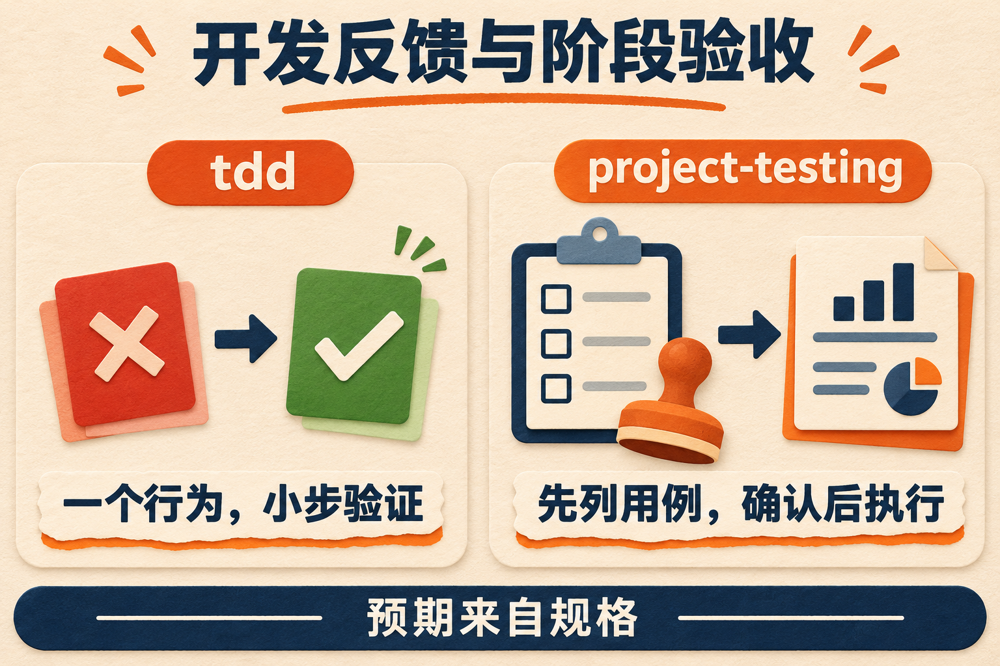

# 手把手教小白Codex从入门到进阶：如何用它完成高质量项目

最近，一位做产品的朋友问我，平时到底是怎么用 Codex 做项目的。

他的问题很具体：提示词怎么写，Skills 怎么选，需求、开发和测试怎么配合，才能把一个想法做成质量过关的项目？

顺着这个问题，我回头梳理了一遍自己的用法：需求文档、项目规则、帮助追问的 Skill、编码约束、测试流程……平时散在不同项目里的做法，放到一起，才更容易看清它们各自解决什么问题。

这套用法也是慢慢摸索出来的。我看过不少 AI 编程项目的宣传、教程和 Skills 推荐，里面有值得借鉴的思路，也有很吸引人的营销表达。我会从中挑选适合自己需求的部分，放进实际项目里试，再根据结果调整、归纳。

从看介绍，到自己动手，再到整理成能反复使用的方法，中间还有很多具体的判断：这个 Skill 解决的是我现在的问题吗？这份规则适合当前项目吗？它给出的结果，我该怎么检查？

对我来说，项目质量要落到几件具体的事上：**需求有依据，改动有边界，结果经过检查，交付留下记录。**

**好的工具值得试，好的方法要在项目里验证。**

今天就借朋友的这个问题，把这些做法整理成一篇从入门到进阶的总结：从第一次怎么提需求，讲到怎样用文档、规则、Skills 和测试把项目做扎实。用过的工具、实际案例和可以后续再加的能力，也会分别说明。

我也把相关配置、提示词、Skills 和练习整理进了一个[配套开源项目](https://github.com/newlightlw/codex-workflow-starter)，方便你边读边试。

下面先简短说入门，再按项目开发的顺序介绍这些组件。你可以先认清它们的分工，遇到对应问题时再拿来用。


*图 1：先做一个小功能，工具按需加入。本文配图为 AI 生成的说明插画。*

## 01 Codex：先用一个小任务熟悉协作

装好 Codex、确认账号可用后，打开正确的项目目录，让它先读项目规则和相关代码，再交给它一个目标、范围和验收条件都明确的小任务。

**第一次照着做：打开项目 → 说清需求 → 实现并验证 → 亲自检查。** 完成后看实际效果、文件改动和测试结果。没有现成项目，可以直接用第 11 节的任务列表练习。

## 先看工具箱：每个组件负责哪一段

当项目从一个小功能变成连续迭代，问题会出现在不同环节：需求还没说清就开始实现，重要约束只留在聊天里，改了一个地方却影响另一个功能，测试结束后又说不清究竟验证了什么。

这些问题需要不同的处理方法。我把常用组件按开发阶段分工：**grill-me 帮我问清需求，Spec 留下验收依据，AGENTS.md 约定协作规则；编码时用约束和测试控制改动，交付时再检查整体结果、留下记录。**

这里先认清三类东西：**Skill** 是可按场景读取的操作说明；**Spec** 是行为与验收规格；**AGENTS.md** 是项目协作规则的入口。它们有的组织讨论，有的保存约定，有的指导实现与检查。

下面这张表就是这套分工的索引。**所有额外 Skills 都是可选的。** “必选”指基础条件或必要动作；小任务的需求可以先写在对话中。表末的并行工具属于按需了解的进阶方法。

| 组件 · 阶段 | 怎么用 · 作用 | 必选 |
| --- | --- | --- |
| **Codex**<br>开始开发 | **用法**：打开正确项目，确认账号可用。<br>**作用**：读代码、实现和验证。 | 必选 |
| **grill-me → grilling**<br>梳理需求 | **用法**：需求模糊时调用，分轮回答。<br>**作用**：问清场景与关键取舍。 | 可选 |
| **需求说明 / Spec**<br>定义任务 | **用法**：写目标、范围、规则和验收。<br>**作用**：让实现和测试有共同依据。 | 必选 |
| **OpenSpec**<br>持续变更 | **用法**：组织提案、设计、规格和任务。<br>**作用**：跟踪需求如何变化、如何交付。 | 可选 |
| **AGENTS.md**<br>进入项目 | **用法**：读取已有规则，按需补充。<br>**作用**：明确入口、约束和交付要求。 | 可选·推荐 |
| **karpathy-guidelines**<br>编码 / 修复 | **用法**：按四条约束核对修改。<br>**作用**：澄清假设，控制改动范围。 | 可选 |
| **tdd / codebase-design**<br>实现行为 | **用法**：确认测试入口，小步先红后绿。<br>**作用**：通过行为检查获得及时反馈。 | 可选 |
| **项目测试与检查命令**<br>开发 / 交付 | **用法**：运行相关检查，记录结果。<br>**作用**：发现回归与验证缺口。 | 必选 |
| **project-testing**<br>整体验收 | **用法**：先列用例，确认后实施。<br>**作用**：核对主流程、异常与人工项。 | 可选 |
| **codex-workflow**<br>复杂任务 / 接续 | **用法**：配置按需使用，核对读取记录。<br>**作用**：组织任务、证据和交付材料。 | 可选·推荐 |
| **learns/、交接文档**<br>收尾 / 接续 | **用法**：写完成项、依据和下一步。<br>**作用**：让后续工作有可核对的起点。 | 可选·推荐 |
| **子 Agent / worktree**<br>可拆分的大任务 | **用法**：获授权后明确分工、隔离目录。<br>**作用**：支持并行调查和实施。 | 可选·进阶 |

接下来就沿着这张表，逐个讲清：什么时候用、怎样用、能带来什么好处。配套仓库附有 7 个 Skill 目录；`grill-me` 是 `grilling` 的调用入口，`codebase-design` 是 `tdd` 按需读取的设计参考，目录数量不等于独立流程数量。[Skills 说明](https://github.com/newlightlw/codex-workflow-starter/blob/main/docs/skills.md)列出了来源、版本与调用方式。[5]

## 02 grill-me：需求追问专家

**使用阶段**：梳理想法、讨论产品方案，尤其是需求还模糊的时候。

**作用**：把需求问清楚，再写成能验收的行为。

“做一个信息整理工具”听起来像任务，实际还留着很多决定：谁来用？从哪里导入？整理之后要做什么？这次先解决哪一个问题？这些取舍会影响后面的实现。

`grill-me` 来自 Matt Pocock 的 Skills 仓库，实际追问由 `grilling` 承担。它按问题之间的依赖分轮提问，每轮给推荐答案；先确定使用场景，再追问由此产生的存储、交互等选择。[2]

**怎么用**：在支持 Skill 调用的客户端里，可以这样开始：

> $grill-me 我想做一个信息整理工具。请先帮我问清目标用户、核心场景、第一版范围和验收条件，再考虑技术方案。

能从项目里查到的事实，让 Codex 自己调查；需要我做的产品取舍，由我回答。双方确认理解一致后，再进入实现。需求明确的小修改可以直接做。

**好处**：把“差不多懂了”变成明确的决定，方便判断第一版该做什么、做到什么程度。我用它讨论过产品想法、商业目标和首批用户，最看重的是把关键取舍提前摆出来。

## 03 Spec / OpenSpec：需求与变更的说明书

**使用阶段**：需求讨论收敛后、开始实现前；持续迭代时同步更新。

**作用**：把已经确认的决定保存下来，让实现、测试和验收对照同一份依据。

我会写清五件事：**背景、目标、范围、约束、验收。** 小任务可以先放在对话或 Issue 中；内容变多后，再整理成项目文档。

**怎么用**：以“完成任务”为例，把一句功能描述展开成可检查的规则：完成后是什么状态？重新打开后是否保留？重复操作怎么办？任务不存在时怎样提示？是否影响其他任务？

其中一条验收场景可以写成：

> 新增一个待完成任务，执行完成命令，再启动新进程查看列表，应该读到该任务的 completed 状态。

项目持续变化时，我用 **OpenSpec** 组织这些材料：`proposal` 写为什么改，`design` 写实现选择，`specs` 写行为，`tasks` 列实施与交付事项。[3] 一份 Markdown 已经能承载规格；OpenSpec 适合在需要管理多轮变更时加入。

**好处**：讨论结果成为可查的约定。规则改了，可以沿着规格更新实现和测试，验收时也知道应当检查什么。

**一条好需求，应该让实现和验收说同一种话。**

## 04 AGENTS.md：项目协作规则入口

**使用阶段**：进入项目时建立或核对，后续开发持续沿用。

**作用**：告诉 Codex 先读哪里、按什么约束修改、怎样验证、完成后更新什么。

我平时说的“系统提示词”，主要指自己能维护的工作指令：全局 AGENTS.md、项目 AGENTS.md 和 Skills。它们属于用户侧的协作约定，与产品内部系统提示词分属不同层次。

全局规则放跨项目习惯，例如先查代码和配置、优先简单方案、保护已有改动、Bug 先复现、交付时报告实际验证。项目规则则指向真实的需求文件、运行命令、测试入口和交付记录。Codex 支持全局与项目分层指令，模块有特殊要求时再补对应规则。[1]

**怎么用**：可以先让 Codex 调查，再整理建议：

> 请读取项目已有规则、README 和测试配置，整理需求入口、运行与测试命令、改动约束及交付要求。保留已有约定，先给出建议内容供我检查。

检查无误后再写入。架构解释、历史决策和当前进度分别留在对应文档中，AGENTS.md 保持简洁，负责指路。

**好处**：反复需要说明的约束有了稳定入口，也能核对它是否真的读到了当前项目的规则。


*图 2：规则、规格和记录各有入口，按当前任务读取。*

## 05 karpathy-guidelines：编码时的四条约束

**使用阶段**：编写代码、修 Bug、审查或重构时。

**作用**：澄清假设、简化方案、控制修改范围，并围绕可验证目标执行。

我用它提醒 Codex 注意四件事：

- **先想清楚**：把假设和不确定的地方说出来。
- **优先简单**：实现当前需要的行为，减少提前设计。
- **精确修改**：沿用项目风格，每处修改都能对应本轮需求。
- **目标可验证**：给每一步配上能检查结果的方法。

**怎么用**：例如给接口增加校验，可以这样交代：

> 请按 karpathy-guidelines 先核对接口调用方式和错误约定，再完成这次校验修改。说明涉及哪些位置，并运行相关行为检查。

**好处**：在看 diff 时，我能把每一处改动和目标对上。小范围修改也更便于定位失败原因、检查兼容性。

这个 Skill 是社区根据 Karpathy 的观察整理的，并非 Karpathy 官方维护。[4] 它提供编码约束，实际改动仍需查看和验证。

## 06 tdd：小步开发的测试教练

**使用阶段**：实现新行为、修复可以复现的 Bug 时。

**作用**：围绕一个可观察的行为，先看到测试失败，再完成足够使它通过的实现。

我的这版 `tdd` 会先确认测试入口，例如 CLI 命令或公开接口，说明能覆盖什么、不能覆盖什么。确认之后，再按“一个测试 → 一次实现”的节奏推进。

**怎么用**：可以从这句话开始：

> $tdd 为任务列表增加“标记完成”。请先读需求和现有代码，提出测试入口，说明覆盖范围；等我确认入口后，再逐个行为实施。

第一个行为检查“完成后重新读取，状态仍然保留”；通过后，再做重复完成、不存在 ID 等检查。测试预期来自规格，断言关注用户能观察的结果。依赖安装失败、路径错误，都不能当作目标行为缺失的有效失败。

当接口边界本身不清楚时，`tdd` 会按需参考 **codebase-design**。它提供模块与接口设计的共同语言，通常不需要单独再跑一遍流程。这版 Skill 把代码整理放到后续 review，具体以随附版本为准。

**好处**：每次改动都能得到针对当前行为的反馈，失败更容易关联到刚发生的修改。测试是否有价值，要看它能否发现需求被破坏。

## 07 project-testing：整体验收检查员

**使用阶段**：进入审核验收、阶段交付，或需要建立项目测试体系时。

**作用**：从需求出发检查主流程、业务规则、异常分支和人工验证项。

`tdd` 关注开发中的小步反馈；`project-testing` 把视角拉回整个交付范围。它会先读需求、代码、测试与配置，列出用例、步骤、预期结果及哪些环节需要人工检查。

**怎么用**：先让它给出清单：

> $project-testing 请先核对当前需求与实现，列出主流程、异常和边界用例，标明自动化与人工验证范围。本轮先给清单。

我审阅清单、回复“可以开始测试”后，它才实施和运行。这是我定制的整体验收流程；日常开发执行已约定的相关测试，沿用已有授权。测试使用临时目录、隔离数据库或合成数据，报告分别记录通过、失败、跳过和未执行。

**好处**：交付时能看清覆盖了哪些需求、还有哪些缺口。测试曾发现一个实际问题：新逻辑写入 `succeeded`，数据库却只接受既有约定的 `completed`。集成检查暴露了冲突，修复恢复了正确状态并保留取消语义。这样的记录也能提醒我，相关检查究竟帮忙发现了什么。



*图 3：tdd 提供开发反馈，project-testing 组织整体验收，预期都来自规格。*

**测试给出的信心，要和它覆盖的范围一样大。**

自动检查、真实服务运行和最终体验分别记录；使用替身通过的环节，仍要说明哪些真实条件没有验证。

## 08 codex-workflow：任务组织与接续助手

**使用阶段**：接入陌生项目、处理复杂任务、跨会话接续或阶段交付时。

**作用**：把已有规格、代码、测试和交接材料组织起来，找出下一项可以验收的任务。

项目做久以后，材料容易分散：规格在一处，最新进度在另一处，某条测试记录可能已经过时。`codex-workflow` 会先读取这些入口，再对照实际代码和证据判断当前状态。已有文档继续复用，小修改沿用项目规则，按复杂度选择步骤。

**怎么用**：首次接入时，核对实际读取的 Skill 路径与项目规则。之后可以自然描述目标：

> 请先核对当前规格、交接记录和代码状态，确认上一阶段完成到哪里，再推进下一项明确任务。交付时写清实现、验证结果和未完成项。

我给本机配置了按需使用规则。在一个实际项目的连续两轮开发中，都有 Skill 和参考文件的读取记录，无需每轮重新输入技能名。

**实际反馈**：这个匿名案例里，我连续两轮说“继续开发”。第一轮完成结果复用能力的实现与隔离验证，**416 项测试通过**；一条旧任务缺少新机制要求的准备证明，恢复入口继续阻断，没有新增真实付费调用。

第二轮读取上一轮交付，处理调用限额版本并准备真实演练，自动检查达到 **428 项通过**。但随后的 **9 次模型调用**被引用换行校验拦住，没有形成完整结果的准备证明。**恢复操作没有执行，自动重试为 0。** 首次失败和费用保留，后续继续排查；真实恢复及其 Cloud 证据仍未验证。


*图 4：上一轮交付成为下一轮入口，自动检查与真实恢复分别记录。*

**好处**：在这两轮里，上一轮材料确实被下一轮读取，约束有据可查，失败也有记录可继续追踪。这些行为由项目规则、Skill 和用户授权共同约束。

**让失败留下证据，下一轮才有机会少走一次弯路。**

案例采用 **2026 年 11 月 13 日**的记录快照。两轮发生在同一项目会话，已有使用约定与按需规则；不能据此证明全新会话自动发现率，也没有量化节省时间。416 与 428 项含重叠回归用例，属于私有项目，不能算成公开练习的成绩。详细分类、失败与后续核对见[案例页](https://github.com/newlightlw/codex-workflow-starter/blob/main/docs/case-project-continuation.md)。

## 09 learns / 交接文档：项目的学习与交付记录

**使用阶段**：阶段结束、准备交接，或为后续开发留下入口时。

**作用**：把完成情况、实现思路、验证结果和下一步变成可读取的材料。

`learns/` 是我存放学习说明的目录，交接文档记录当前状态。它们是项目文件，文件名可以沿用自己的习惯。`codex-workflow` 负责组织和核对这些材料。

**怎么用**：收尾时先看 diff，检查错误条件、兼容性及无关修改；再让 Codex 回答四个问题：

- 这轮完成了什么，入口在哪里？
- 哪些命令实际跑过，结果如何？
- 哪些部分未验证，下一步受什么约束？
- 下一项可以独立验收的任务是什么？

**好处**：以后回来看代码时，能查到“为什么这样做”和“目前验证到哪”。实施者复查属于自审；独立审查仍需要另一位审查者或获授权的独立 Agent 阅读原始需求与改动。

反复遇到的问题再按需要沉淀：行为回归写成测试，易错命令修进脚本，稳定约束放进 AGENTS.md，重复流程整理成 Skill。

## 10 子 Agent / worktree：按需使用的并行工具

**使用阶段**：任务能够拆出独立职责、单条主流程已经跑通之后。

**作用**：分工处理可并行的工作，并隔离各自的代码修改目录。

**怎么用**：先明确每项工作的输入、输出、可写范围和完成标准，经授权后再让子 Agent 分别调查或实施，由主任务整合。[6] worktree 隔离代码目录；数据库、端口、队列和外部账号仍需单独安排，合并结果也要验证。[7]

**好处**：适合职责清楚、相互依赖较少的大任务。拆分和整合本身也有成本，小修改沿用单条流程即可。这部分属于配套资料中的进阶方法，本文没有把它算作已完成的并行实测。

需要自动化时，再考虑 `codex exec` 等非交互入口；先查本机帮助和[CLI 说明](https://github.com/newlightlw/codex-workflow-starter/blob/main/docs/codex-reference.md)。命令语法检查与真实模型执行分别记录。[8] Sandbox、Approval 及客户端环境共同约束实际执行，部署、发信和生产修改仍要结合具体授权。[9]

## 11 Taskbox：把这些组件串起来练一次

**使用阶段**：了解分工后，选一个小任务动手试用。

**作用**：用公开练习走完需求、实现、测试和交付，观察这些组件怎样配合。


*图 5：用一个小练习，把需求、实现、验证和记录走一遍。*

**Taskbox** 只做新增任务、查看列表、标记完成，数据保存在本地 JSON。Python 部分只用标准库，不需要数据库、模型密钥或外部 API；与 Codex 对话仍需要自己的可用账号。

**怎么用**：准备 Python 3.11+，下载仓库并运行参考实现的检查：

```bash
git clone https://github.com/newlightlw/codex-workflow-starter.git
cd codex-workflow-starter
python3 -m unittest discover -s tests -v
```

Windows 可按 README 使用 `py -3`；也可以下载 ZIP。然后在仓库根目录生成独立练习：

```bash
python3 scripts/new_exercise.py ../my-codex-practice
```

新目录保留“新增、查看”，把“完成任务”留给你和 Codex 实现，并附一个预期失败的主流程测试。脚本拒绝覆盖已有目录，不修改全局配置。

在 Codex 中打开 `my-codex-practice`，先发：

```text
请先读 AGENTS.md、README.md 和 docs/requirements.md。
列出实际读取的规则与 Skills 路径、需求范围和测试命令。
本轮只核对，不修改代码。
```

确认材料正确后，按练习 README 使用 `tdd`，确认测试入口，从预置失败开始，逐个补齐行为。最后亲手走一次“新增 → 完成 → 重新查看”，并读一遍 diff 与交接。完整步骤见[从零复现](https://github.com/newlightlw/codex-workflow-starter/blob/main/docs/start-here.md)；客户端或同名全局 Skill 可能影响读取路径，要核对实际版本。[5]

**好处**：能在一个小范围里理解各组件的作用，再判断自己的项目缺哪一部分。已有项目可按[接入指南](https://github.com/newlightlw/codex-workflow-starter/blob/main/docs/adoption.md)只引入 `codex-workflow`，其余工具按需要选。仓库还附有 12 组提示词、规格示例与交接模板。

**能说清怎样才算完成，才知道该检查什么。**

回到朋友的问题，我会从一次具体任务开始讲：先确定问题，再选合适的组件，让需求、实现和验证有据可查。随着项目变复杂，把实际有效的做法整理成自己的规则。

配套练习与完整步骤：[github.com/newlightlw/codex-workflow-starter](https://github.com/newlightlw/codex-workflow-starter)。

原创代码、模板、文章与自定义 Skills 采用 MIT 许可；第三方 Skills 保留来源、版本和许可说明。欢迎反馈具体的复现问题。

---

资料与工具来源：

1. [Codex：AGENTS.md](https://learn.chatgpt.com/docs/agent-configuration/agents-md)
2. [Matt Pocock：Skills](https://github.com/mattpocock/skills)
3. [Fission-AI：OpenSpec](https://github.com/Fission-AI/OpenSpec)
4. [社区整理的 Karpathy Guidelines](https://github.com/multica-ai/andrej-karpathy-skills)
5. [Codex：Skills](https://learn.chatgpt.com/docs/build-skills)
6. [Codex：Subagents](https://learn.chatgpt.com/docs/agent-configuration/subagents)
7. [Codex：Worktrees](https://learn.chatgpt.com/docs/environments/git-worktrees)
8. [Codex：CLI 参考](https://learn.chatgpt.com/docs/cli/reference)
9. [Codex：权限与执行边界](https://learn.chatgpt.com/docs/agent-approvals-security)

本文与配套仓库版本为 v0.2.9（2026 年 11 月 13 日）。案例沿用已注明时间的记录；具体复现范围和版本见仓库文档。
