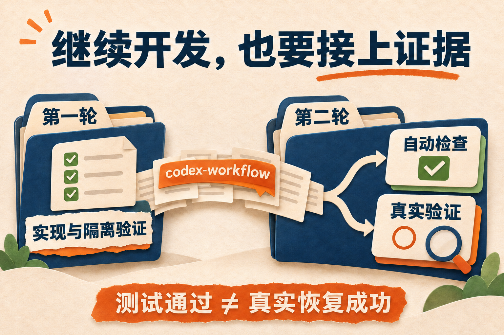

# 刚装好 Codex？先用这 4 步完成第一个功能

Codex 装好了，账号也登录了。面对输入框，第一句话该说什么？

“帮我做一个网站。”“写一个待办工具。”

这样的请求能让一次尝试开始。可当 Codex 交来一批文件和运行命令，你还需要判断：**它理解的需求对不对？这次改了哪些地方？结果该怎么检查？**

这些判断，值得从第一次使用就练习。

**把 Codex 用顺手，从把一件小事交代清楚开始。**

这篇文章写给刚装好 Codex、准备做第一个功能的人。我把自己开发项目时的做法拆成一条上手路线：怎样提需求、怎样设规则、什么时候用 Skill，以及如何确认结果。

先照着第 1 节走一遍基本步骤，再到第 8 节动手练习。遇到需求不清、改动难控制或验证没把握，再回来看对应的方法和工具。

配套练习、配置与提示词：[github.com/newlightlw/codex-workflow-starter](https://github.com/newlightlw/codex-workflow-starter)。


*图 1：先做一个小功能，工具按需加入。本文配图为 AI 生成的说明插画。*

## 01 第一次使用，先走完这 4 步

**第一步，打开正确的项目。** 先确认 Codex 正在查看哪个目录，让它读已有的规则、需求和相关代码，说明项目怎样运行、怎样测试。没有现成项目，可以直接用第 8 节的任务列表练习。

**第二步，说清一个小任务。** 先选一个能单独检查的功能，例如“给任务增加完成状态”。说清要达到的效果、这次改到哪里，以及什么结果算完成；拿不准的关键问题，再让 Codex 帮你梳理。

**第三步，让实现和验证一起推进。** 信息充分后，让 Codex 完成必要修改、运行相关检查，并说明结果。出现报错时保留完整错误，沿着原因修复。安装依赖失败、测试没跑起来，都需要单独处理。

**第四步，亲自检查结果。** 按刚才约定的步骤实际用一次，查看文件改动及说明，确认已有功能没有被意外影响。让 Codex 记录完成项、验证结果和未验证部分。

下面以任务列表练习为例。这段话可以作为起手模板，换成自己项目的目标和验收条件：

```text
我想给当前项目的任务列表增加“标记完成”功能。
请先读已有项目规则、需求和相关代码，确认当前实现与测试入口。
目标：完成后能在列表中看到状态变化，重新打开后仍然保留。
范围：这次只做这个功能，保留已有行为。
请指出需要澄清的关键问题；信息足够时完成最小修改，运行相关测试。
结束时说明改了什么、怎样验证，还有哪些没有验证。
```

用本文练习时，仍先按第 8 节核对材料，并遵守随附 Skill 的测试入口确认流程。模板里的价值在于**目标、范围和验收条件**；这些内容要随着具体任务调整。

**工具怎么选？先认识它们各自解决什么问题。**

先解释三个名字：**Spec** 是行为与验收规格，**Skill** 是按场景读取的操作说明，**AGENTS.md** 是项目协作规则的入口。

我负责目标、关键取舍和最终体验；Codex 负责读取项目、实现、运行验证和更新记录。工具围绕这份分工来选。

**所有额外 Skills 都是可选的。** 表中的“必选”指基础条件或必要动作；“可选·推荐”表示值得优先采用。小任务的需求可以先写在对话中，复杂起来再整理成文档。项目已有的规则和规格，接手时仍要遵守。

| 组件 · 阶段 | 怎么用 · 作用 | 必选 |
| --- | --- | --- |
| **Codex**<br>开始开发 | **用法**：打开正确项目，确认账号可用。<br>**作用**：读代码、实现和验证。 | 必选 |
| **AGENTS.md**<br>进入项目 | **用法**：读取已有规则，按需补充。<br>**作用**：约定入口、约束和交付。 | 可选·推荐 |
| **codex-workflow**<br>复杂任务 / 接续 | **用法**：配置按需使用规则，核对实际读取记录。<br>**作用**：组织任务与接续材料。 | 可选·推荐 |
| **grill-me → grilling**<br>澄清需求 | **用法**：需求模糊时调用，分轮回答。<br>**作用**：问清场景与关键取舍。 | 可选 |
| **需求与验收说明 / Spec**<br>定义任务 | **用法**：写目标、范围、规则与验收，小任务可先写在对话中。<br>**作用**：统一实现和测试的依据。 | 必选 |
| **OpenSpec**<br>持续变更 | **用法**：记录提案、设计、规格和任务。<br>**作用**：管理变更及其交付。 | 可选 |
| **karpathy-guidelines**<br>编码 / 修复 | **用法**：读取并遵循编码约束。<br>**作用**：核对假设，控制改动。 | 可选 |
| **tdd / codebase-design**<br>实现行为 | **用法**：确认测试入口，先红后绿，按需读设计参考。<br>**作用**：获得小步反馈。 | 可选 |
| **项目测试与检查命令**<br>开发 / 交付 | **用法**：运行相关检查，记录结果。<br>**作用**：发现回归与验证缺口。 | 必选 |
| **project-testing**<br>整体验收 | **用法**：先列用例，确认后实施。<br>**作用**：检查需求、异常与人工项。 | 可选 |
| **learns/、交接文档**<br>交付 / 接续 | **用法**：更新完成项、证据和下一步。<br>**作用**：帮助下次恢复项目状态。 | 可选·推荐 |
| **子 Agent / worktree**<br>可拆分的大任务 | **用法**：明确分工并获授权后，按需使用。<br>**作用**：分工、隔离代码目录。 | 可选·进阶 |

`grill-me` 是 `grilling` 的调用入口；`codebase-design` 是 `tdd` 会按需读取的设计参考。仓库已附这 7 个 Skill 目录，无需再全局安装一遍。具体入口和版本核对见 [Skills 说明](https://github.com/newlightlw/codex-workflow-starter/blob/main/docs/skills.md)。

**第一次照着做：打开项目 → 读规则 → 写清一个小功能 → 实现并验证。** 一份 Markdown 就能写规格，OpenSpec 可以之后再加。

## 02 把需求问清楚，再写成能验收的行为

“做一个信息整理工具”听起来像任务，实际还留着很多决定：谁来用？从哪里导入？整理之后要做什么？这次先解决哪一个问题？

这时可以直接让 Codex 先追问关键条件。我还用了 `grill-me` 来组织这一步：它来自 Matt Pocock 的 Skills 仓库，实际追问流程由 `grilling` 承担。[2]

它把问题拆成有先后依赖的几轮，每轮附上推荐答案。先确定使用场景，再讨论存储和交互。我用它讨论过产品想法、商业目标和首批用户。仓库能查到的事实，交给 Codex 调查；需要我取舍的产品方向，由我回答。清楚的小修改直接做。

讨论收敛后，我会写下五件事：**背景、目标、范围、约束、验收。** 它们可以放在 Issue，也可以放在项目文档里。

比如给任务列表增加“完成”功能，至少要说清楚：

> 完成后变成什么状态？重启后还在吗？重复完成会怎样？任务不存在时如何提示？会不会改到别的任务？

进一步写成一条验收场景：

> 新增一个待完成任务，执行完成命令，再启动新进程查看列表，应该读到该任务的 completed 状态。

这句话给出了操作，也给出了检查结果的方法。

**一条好需求，应该让实现和验收说同一种话。**

持续迭代的项目里，我用 **OpenSpec** 管理这些变化：`proposal` 写原因，`design` 写实现选择，`specs` 写行为，`tasks` 列实施与交付事项。[3] 大任务拆成小阶段，每阶段都能单独验证；规则改了，就同步规格和测试预期。

## 03 给 Codex 一个清晰的项目入口

我平时说的“系统提示词”，主要是自己能维护的工作指令：全局 AGENTS.md、项目 AGENTS.md 和 Skills。这些属于用户侧协作约定，与产品内部系统提示词分属不同层次。

我的全局规则抓住几件事：先查目标、代码、测试和配置；优先简单方案；做最小完整修改；保护已有改动；Bug 先复现，再追根因；交付时说明实际验证结果。

节奏也写清楚：正常开发默认持续完成，遇到重大取舍、真实外部副作用，或查不到的关键信息，再停下来问我。

到了具体项目，AGENTS.md 要指向真实入口：**先读哪份需求，哪些约束必须保留，运行什么测试，完成时更新哪里。** Codex 提供全局和项目分层的指令机制；模块有独特要求时，也可以放对应规则。[1]

架构解释、历史决策和当前进度分别留在项目文档中，AGENTS.md 保持简洁，负责把它引到正确的位置。

刚开始用时，可以先请 Codex 把已确认的运行命令、测试命令和改动约束整理成建议，检查无误后再写入。路径和命令应来自当前项目；已有规则继续保留。


*图 2：规则、规格和记录各有入口，按当前任务读取。*

## 04 用测试推进一个功能，也看清验证的边界

编码时，我会用 `karpathy-guidelines`：先想清楚、优先简单、精确修改、围绕可验证目标执行。它是社区整理的 Skill，并非 Karpathy 官方维护。[4]

例如给接口增加校验，先查调用方式和错误约定，再改必要位置，最后验证相关行为。范围小，结果更容易判断。

测试方面，我把开发反馈和整体验收分开。第一次做小功能，先弄清项目已有的检查命令，再让 Codex 补充这次行为的验证；下面两种 Skill 用来把流程做得更明确。

**开发一个行为，用 `tdd` 小步推进。** 先确认公开测试入口，例如 CLI 命令；写一个因目标行为缺失而失败的测试，做足够使它通过的实现，再进入下一个行为。依赖安装失败、路径写错，都不算这一轮有效的“红灯”。

预期来自规格，断言检查用户能观察的结果。我用的这版 Skill 把代码整理放到后续 review；实际流程应以随附版本为准。

**做整体验收，用 `project-testing`。** 它先读需求、代码和测试，列出用例、步骤、预期及人工项。我确认清单、回复“可以开始测试”后，再实施运行。日常开发执行已约定的相关测试，沿用已有授权。


*图 3：小步反馈与整体验收分工明确，预期都来自规格。*

测试曾帮我抓住一个很具体的问题：某个功能的一段新逻辑把完成状态写成了 `succeeded`，数据库却只接受既有约定的 `completed`。集成检查暴露了冲突，修复时恢复正确状态，同时保留取消语义。

这样的反馈让我能把问题定位到接口、持久化和状态约束之间，而不只凭一次回复判断“应该好了”。

**测试给出的信心，要和它覆盖的范围一样大。**

我会分别记录自动检查、真实服务运行和最终体验。测试用临时目录、隔离数据库或合成数据；报告写清通过、失败、跳过和未执行，也写清替身和未覆盖的真实环节。

## 05 实际做项目时，这些方法怎样配合

下面用一个匿名案例说明。你可以先完成第 8 节的小练习，再回来看这些方法在复杂任务里怎样配合。

在这个项目中，阶段结束时，我会更新 `learns/`，说明完成了什么、怎样读实现、为什么这样设计、验证到了哪里。

`codex-workflow` 把已有材料组织起来：先读规格与交接，再核对实际代码和验证记录，最后推进下一项明确任务。已有文档继续使用；小修改沿用项目规则，按复杂度选择需要的步骤。

配置好按需使用规则后，这两轮都记录了 Skill 及参考文件的实际读取。我无需每轮重输技能名。



*图 4：两轮案例快照；自动检查与真实恢复分别记录。*

**第一轮：把恢复能力做出来。**

这一轮要解决的是：任务已经产生完整结果，却在最终提交前中断，能否复用结果、避免重复调用？

Codex 读取上一阶段材料，核对产物摘要并保存修改前的基线，然后实施、验证、更新学习说明和验收记录。最终 **416 项测试通过**，代码风格、类型、前端构建和规格检查也通过。

但一条旧任务记录没有新机制要求的“结果准备证明”。即使原结果仍能读取，恢复入口也继续阻断。这轮完成了实现与隔离验证，没有新增真实付费调用；真实故障恢复留给下一阶段。

**第二轮：让真实运行来检验。**

我再次说“继续开发”。Codex 接上上一轮交付，处理调用限额版本，并准备真实演练。首次演练前，自动检查达到 **428 项通过**。

真实运行随后发生了 **9 次模型调用**，却被引用校验拦住：模型移动了引文中的换行，文字相同，原文行却对应不上。

它还没走到预设的中断演练，没有形成完整结果的准备证明。**恢复操作没有执行，自动重试为 0。** 这次记录因此不能写成“真实恢复成功”。

随后排查保留严格校验，补充差异记录、调整引用提示，再安排单独复核。首次失败和费用继续保留；该次真实恢复及其 Cloud 证据仍未验证。

**让失败留下证据，下一轮才有机会少走一次弯路。**

这两轮最有用的反馈是：上一轮的交付确实被下一轮读取，约束有据可查，自动检查与真实运行分别报告。我不用重新解释整个项目，遇到失败也能沿着记录继续查。

案例采用 **2026 年 11 月 13 日**的记录快照，两轮发生在同一项目会话，已有使用约定与按需规则。它还不能证明全新会话的自动触发率，也没有测出节省多少时间。416 与 428 项包含重叠回归用例，属于私有项目，不能算成开源示例的成绩。详细分类、失败记录与证据边界见[案例页](https://github.com/newlightlw/codex-workflow-starter/blob/main/docs/case-project-continuation.md)。

## 06 收尾时，给下一轮留一份能用的交接

测试之后，我还会检查改动本身：有没有遗漏的错误条件、兼容性影响，或者与本轮目标无关的修改？

先确定比较基准，再看 diff 和上下文。发现问题要写触发条件、影响和位置；修复后重跑相关检查。实施者复查属于自审；独立审查需要另一位审查者或获授权的独立 Agent 读取原始需求与改动。

交接至少回答四个问题：

- 这轮完成了什么，入口在哪里？
- 哪些命令实际跑过，结果如何？
- 哪些部分未验证，下一步受什么约束？
- 下一项可以独立验收的任务是什么？

复盘时再决定沉淀到哪里：行为回归写成测试，易错命令修进脚本，稳定约束放进 AGENTS.md，重复流程整理成 Skill。偶发问题留下修复记录即可，规则按实际需要增加。

## 07 进阶工具，等项目需要时再加

子 Agent、worktree 和 CLI 自动化，可以等主流程跑通后再考虑。

任务能拆出独立职责时，可以让子 Agent 分别调查实现和测试缺口；先明确输入、输出、可写范围及完成标准，再由主任务整合。[6]

worktree 隔离代码工作目录，数据库、端口、队列和外部账号仍需单独安排。分支各自通过后，合并结果还要检查。[7] 仓库提供这部分方法与示例，本文没有把它算作已完成的并行实测。

交互会话适合共同探索；`codex exec` 可用于非交互流程。具体入口和权限以所用版本为准：先读本机帮助，再查仓库的 [CLI 说明](https://github.com/newlightlw/codex-workflow-starter/blob/main/docs/codex-reference.md)。命令语法检查与真实模型执行分别记录。[8]

Sandbox 管资源访问范围，Approval 管额外确认，实际执行还受客户端和环境约束。部署、发信或修改生产数据，要结合具体任务与既有授权判断。[9]

## 08 从一个小练习，走到自己的项目


*图 5：用一个小练习，把需求、实现、验证和记录走一遍。*

仓库里的 **Taskbox** 只做三件事：新增任务、查看列表、标记完成。数据存本地 JSON，Python 部分只用标准库，不需要数据库、模型密钥或外部 API。与 Codex 对话仍需要你自己的可用账号。

这个体量，足够把需求、实现、测试和交接走完整。

**第一步，运行参考实现。** 准备 Python 3.11+，用 Git 下载并执行：

```bash
git clone https://github.com/newlightlw/codex-workflow-starter.git
cd codex-workflow-starter
python3 -m unittest discover -s tests -v
```

Windows 可按 README 使用 `py -3`。也可下载 ZIP，进入解压目录执行测试。

**第二步，生成独立练习。** 在仓库根目录执行：

```bash
python3 scripts/new_exercise.py ../my-codex-practice
```

新目录保留“新增、查看”，把“完成任务”留给你和 Codex 实现，并附一个预期失败的主流程测试。脚本会拒绝覆盖已有目录，不修改全局配置。

**第三步，让 Codex 先确认读到了什么。** 在 Codex 中打开 `my-codex-practice`，发出：

```text
请先读 AGENTS.md、README.md 和 docs/requirements.md。
列出实际读取的规则与 Skills 路径、需求范围和测试命令。
本轮只核对，不修改代码。
```

确认材料正确后，按练习 README 使用 `tdd`：确认测试入口，从预置失败开始，再补重复完成、不存在 ID 等行为，完成实现和验证。最后手动走一次“新增 → 完成 → 重新查看”，并读一遍 diff 与交接记录。

完整步骤见[从零复现](https://github.com/newlightlw/codex-workflow-starter/blob/main/docs/start-here.md)。客户端的 Skill 发现方式可能不同；有同名全局版本时，要核对实际路径。[5] OpenSpec 仍放在进阶步骤。

**已有项目，可以只接入 `codex-workflow`。** [接入工具](https://github.com/newlightlw/codex-workflow-starter/blob/main/docs/adoption.md)默认预览，加 `--apply` 才复制 Skill；保留已有配置，遇到同名目录会停止。它不要求安装其余 Skills。

仓库还附了 12 组提示词、规格示例和交接模板。先用一个小功能验证适不适合自己，再按真实需要调整。

**能说清怎样才算完成，才知道该检查什么。**

第一次使用，就从一个小功能开始：把需求说清楚，让 Codex 实现并验证，再亲手检查结果。把这套过程走一遍，后面遇到更大的任务，就有了可以沿用的方法。

配套练习与完整步骤：[github.com/newlightlw/codex-workflow-starter](https://github.com/newlightlw/codex-workflow-starter)。

原创代码、模板、文章与自定义 Skills 采用 MIT 许可；第三方 Skills 保留来源、版本和许可说明。欢迎反馈具体的复现问题。

---

资料与工具来源：

1. [Codex：AGENTS.md](https://learn.chatgpt.com/docs/agent-configuration/agents-md)
2. [Matt Pocock：Skills](https://github.com/mattpocock/skills)
3. [Fission-AI：OpenSpec](https://github.com/Fission-AI/OpenSpec)
4. [社区整理的 Karpathy Guidelines](https://github.com/multica-ai/andrej-karpathy-skills)
5. [Codex：Skills](https://learn.chatgpt.com/docs/build-skills)
6. [Codex：Subagents](https://learn.chatgpt.com/docs/agent-configuration/subagents)
7. [Codex：Worktrees](https://learn.chatgpt.com/docs/environments/git-worktrees)
8. [Codex：CLI 参考](https://learn.chatgpt.com/docs/cli/reference)
9. [Codex：权限与执行边界](https://learn.chatgpt.com/docs/agent-approvals-security)

本文与配套仓库版本为 v0.2.7（2026 年 11 月 13 日）。案例沿用已注明时间的记录；具体复现范围和版本见仓库文档。
