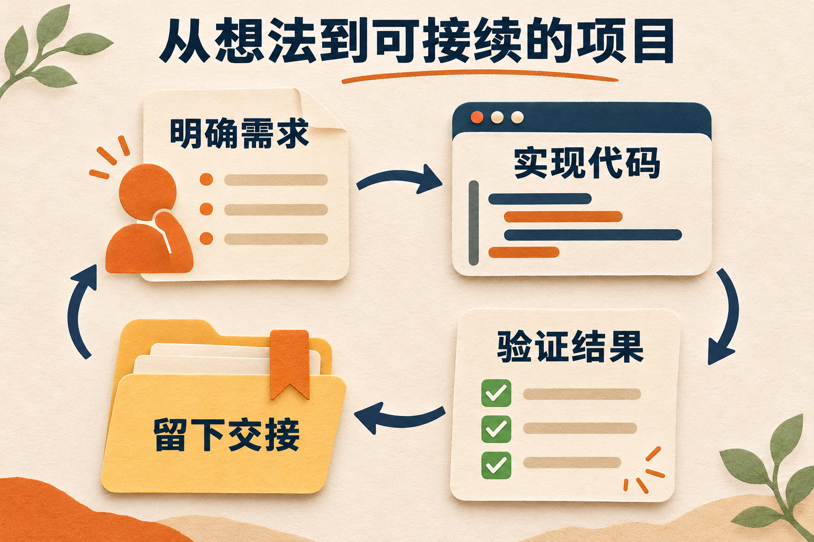

# 我用 Codex 做项目的工作流，整理成了一个开源仓库

最近有朋友问我：你平时用 Codex 开发项目，到底配了哪些东西？用了什么 Spec、什么提示词，又装了哪些 Skills？

认真梳理之后，我发现，值得分享的是这些东西怎样配合。

**我负责确定目标、关键取舍和最终体验；Codex 负责读取项目、实现功能、运行验证，并留下下一次能接着用的文档。**

这套工作方式里，有 OpenSpec，有我自己维护的 AGENTS.md，也有 karpathy-guidelines、grill-me、tdd，以及我定制的 project-testing。最近，我还把整理出的 `codex-workflow` 用到了真实项目的后续开发中。

为了让朋友和读者能照着做，我把核心配置整理成了一个开源仓库，附带可运行的小项目、独立练习和操作说明。

**开源项目：[github.com/newlightlw/codex-workflow-starter](https://github.com/newlightlw/codex-workflow-starter)**

可以先收藏，边读边对照仓库里的配置、提示词和练习。

这次又参考了一份更完整的工程实践教程，补上任务组织、跨会话恢复、审查和并行边界。新增的工作流入口已经在我的 Deep Agents 工作台中连续用于两轮开发，下面会给出具体过程和反馈；多 Agent、worktree 等仍作为可选扩展介绍。



*图 1：每一步留下下一步能使用的依据。本文配图均为 AI 生成的说明插画。*

**先看这张表：每个阶段该用什么？**

“Spec”就是写清行为与验收条件的规格；“Skill”是按场景读取的一组操作说明；“AGENTS.md”是项目协作规则的入口。它们各有分工。

表中的“必选”指完成本文开发流程需要的基础条件或动作。**所有额外 Skills 都是可选的；明确需求、验证结果则不能省。** “可选·推荐”表示我建议优先采用，但不要求先装齐。

| 组件 · 阶段 | 怎么用 · 作用 | 必选 |
| --- | --- | --- |
| **Codex**<br>开始开发 | **用法**：打开项目，确认账号可用、目录正确。<br>**作用**：读取项目、修改代码、执行验证。 | 必选 |
| **AGENTS.md**<br>进入项目 / 全程 | **用法**：先读已有规则；需要时合并自己的约定。<br>**作用**：约定读什么、怎么改、怎样交付。 | 可选·推荐 |
| **codex-workflow**<br>复杂任务 / 接续 | **用法**：配置按需使用规则后，由 Codex 在匹配任务时读取；核对实际读取记录。<br>**作用**：组织任务，接上规格、进度与验证证据。 | 可选·推荐 |
| **grill-me → grilling**<br>澄清想法 | **用法**：需求模糊时，让 Codex 使用它分轮追问。<br>**作用**：把场景、范围和关键取舍问清楚。 | 可选 |
| **需求文档 / Spec**<br>定义任务 | **用法**：写清目标、范围、规则和验收；一份 Markdown 即可。<br>**作用**：让实现与测试有共同依据。 | 必选 |
| **OpenSpec**<br>管理持续变更 | **用法**：按 proposal、design、specs、tasks 记录一次变更。<br>**作用**：保留变更原因、行为和交付清单。 | 可选 |
| **karpathy-guidelines**<br>编码 / 修复 | **用法**：让 Codex 读取并遵循这组编码约束。<br>**作用**：先核对假设，再做简单、必要的修改。 | 可选 |
| **tdd / codebase-design**<br>实现具体行为 | **用法**：确认测试入口，先红灯再实现到绿灯；按需读设计参考。<br>**作用**：用小步测试反馈约束实现。 | 可选 |
| **项目测试与检查命令**<br>开发 / 交付 | **用法**：执行与改动相关的测试、类型或构建检查，记录结果。<br>**作用**：验证行为，发现回归和未覆盖项。 | 必选 |
| **project-testing**<br>整体验收 | **用法**：先列用例；确认“可以开始测试”后再实施运行。<br>**作用**：覆盖需求、异常和人工验收项。 | 可选 |
| **learns/、交接文档**<br>交付 / 换会话 | **用法**：复用已有文档，记下完成项、验证结果与下一步。<br>**作用**：帮助理解实现、恢复项目状态。 | 可选·推荐 |
| **子 Agent / worktree**<br>可拆分的大任务 | **用法**：有明确分工且获授权时使用；需要隔离改动时再开 worktree。<br>**作用**：分工调查或实施，隔离工作目录。 | 可选·进阶 |

这里的“可选”是说是否新增这套工具或文件；项目已有的 AGENTS.md、规格和测试约定，接手时仍要遵守。`grill-me` 是 `grilling` 的入口；`codebase-design` 是 `tdd` 会按需读取的设计参考，不必把每个名字都当成独立步骤。

**第一次照着做：在 Codex 中打开项目 → 读取现有规则 → 用一份文档写清小功能 → 完成实现并运行相关验证。** 本仓库已带上表中的 7 个 Skill 目录，无需再全局安装一遍；OpenSpec 是另外的进阶工具。先走通这条路线，再按遇到的问题选用 Skill。具体调用和版本核对方法见仓库的 [Skills 说明](https://github.com/newlightlw/codex-workflow-starter/blob/main/docs/skills.md)。

## 01 先把协作规则写下来

我平时说的“系统提示词”，主要指我能维护的长期工作指令：全局 AGENTS.md、项目 AGENTS.md，以及 Skills 里的规则。

这些是用户侧的协作约定，与产品内部的系统提示词属于不同层次。

全局规则里，我最在意几件事：

- 先核对目标、代码、测试和配置，再修改。
- 优先简单、清晰、依赖少的方案。
- 做最小完整修改，保护已有工作。
- Bug 先复现，再找根因，补适合的回归测试。
- 运行与风险匹配的验证，如实说明结果和缺口。

我也写明：正常开发默认持续完成；遇到重大产品或架构取舍、真实外部副作用，或者无法从仓库查到的关键信息，再停下来问我。

这决定了协作的节奏。已经说清楚的任务，可以连贯推进；需要我做决定的地方，要把问题和依据摆出来。

到了具体项目，项目级 AGENTS.md 要指明：先读哪份主文档，当前阶段是什么，运行什么测试，完成时更新哪些说明。

模块有独特约束时，还可以在子目录放对应指令。详细架构、历史取舍和当前进度分别放进项目文档，AGENTS.md 留下稳定规则与读取入口。

**规则放在明确入口里，下一次会话就有机会沿着同一条路进入项目。** Codex 官方提供了 AGENTS.md 的全局与项目分层机制，仓库里也给出了可直接参考的模板。[1]


*图 2：规则、规格与记录各有入口，按当前任务读取。*

## 02 想法模糊时，我会让它继续问

我装了一个叫 `grill-me` 的 Skill，实际追问流程由 `grilling` 承担，来自 Matt Pocock 的 Skills 仓库。[2]

它的价值在于把一个想法拆成有依赖的决策，分轮往下问。

例如，“我想做一个信息整理工具”还不足以进入开发。它需要继续问：谁会用？最近一次遇到这个问题是什么时候？从哪里导入内容？整理之后做什么？怎样算有用？

前一轮决定了使用场景，下一轮才有条件讨论存储、交互和自动化程度。每个问题会附上推荐答案，方便我判断和修正。

能从仓库查到的事实，应该由 Codex 自己调查。涉及产品方向的选择，则需要我回答。

我确实用过这种方式讨论产品想法，包括商业目标、原有产品预设是否值得保留，以及能接触到哪些首批用户。

需求已经清楚的小修改，可以直接做。这个 Skill 更适合帮助我把含糊的想法说清楚。

到了陌生项目，即使目标已经明确，也要先做有范围的探索：沿着本次功能的入口，找到相关模块、数据流、现成实现和测试命令。事实查清后再给计划；已经授权、没有关键歧义的任务，可以接着实施。

## 03 把需求写成能验收的工程任务

我会先把已经确认的讨论收敛成开发文档，写清目标、范围、业务规则、状态变化、异常处理和验收条件。

这次增补里，我把任务模板整理成五个部分：背景说明为什么做，目标说明用户会得到什么，范围限定本次变化，约束保留兼容与数据边界，验收给出可观察的完成证据。

它可以是一条 Issue，也可以是项目中的 Markdown 文件。重要的是让接手任务的人或 Agent 找得到完整依据。

比如，“支持任务完成”仍然太宽。写到可开发的程度，至少要回答：

> 完成后是什么状态？重新打开还能看到吗？重复点击会怎样？任务不存在时如何处理？会不会改到其他任务？

这些问题确定下来，代码和测试才有共同依据。

在需要持续管理变更的项目里，我使用 **OpenSpec**。[3]

它把一次变更组织成几类文件：`proposal` 说明为什么做，`design` 记录实现选择，`specs` 定义行为，`tasks` 列出实施与交付事项。

例如本文配套的小项目，一条场景可以写成：

> 当用户新增一个待完成任务，执行完成命令，再启动一个新进程查看列表，应该读到该任务的 completed 状态。

这条描述同时给出了使用路径和可观察结果。后续实现与测试，都能围绕它展开。

我还会把大项目拆成可独立验证的小阶段。每个阶段留下规格、实现、验证记录和必要说明，再继续下一步。

主文档和已接受的变更要保持一致。需求变化后，测试的预期也要跟着确认后的规则更新。

## 04 编码和测试，各有一套约束

编码时，我会用 `karpathy-guidelines` 约束常见问题。它是社区根据 Karpathy 的公开观察整理的 Skill，包含四个核心原则：先想清楚、优先简单、精确修改、围绕可验证目标执行。[4]

例如给接口补一个校验，就先确认现有调用与错误约定，修改必要位置，再验证相关行为。

测试方面，我把开发中的小步反馈和阶段验收分开处理。

**开发一个行为时，可以使用 `tdd`。**

先确认测试入口，比如公开 API、CLI 命令或用户操作路径。然后写一个因为目标行为缺失而失败的测试，做足够使它通过的实现，再进入下一个行为。

这个过程中，预期结果应来自规格。测试要检查用户能观察的结果，避免只验证某个内部函数是否被调用。

还有一个容易忽略的版本细节：我使用的这版 tdd 把代码整理放到后续 review，红灯到绿灯的实现循环保持聚焦。使用 Skill 时，最好读一遍实际内容。

**到了项目验收，我会使用自己定制的 `project-testing`。**

它先读需求、代码和已有测试，把需求映射成用例清单，写清前置条件、操作步骤、预期结果，以及适合自动化还是需要人工检查。

我确认清单、回复“可以开始测试”后，它再实施和运行。这个确认用于建立整体验收范围；日常开发中执行已约定的相关测试，可以按已有授权继续。

测试数据使用临时目录、隔离数据库或合成数据。报告要区分通过、失败、跳过和未执行，并说明用了哪些替身、没有覆盖哪些真实环节。


*图 3：开发中的小步反馈与整体验收分工明确，预期都来自规格。*

## 05 一个真实项目里，测试怎样改变了结果

我的 Deep Agents 工作台曾做过一个“受控网页抓取与来源快照”的子阶段。

开发时，新逻辑把完成状态写成了 `succeeded`。集成检查发现，它不符合已有数据库的状态约束。

修复时，状态回到既有约定的 `completed`，同时保留取消语义。

这件小事让我觉得，**测试的价值很具体：让真实实现穿过接口、持久化和状态约束，把不一致暴露出来。**

2026 年 11 月 12 日的该阶段记录有 336 项自动化检查通过，包含单元、断网合同和隔离 PostgreSQL 集成测试；另做过一次公开文档抓取实测。

这是当时那个子阶段的历史结果。付费搜索、正式研究执行、部署与文章验收等后续事项，当时仍有明确的未完成范围。本文没有重跑那个私有项目，也不会把它的测试数算到下面的开源示例里。

对于 Agent 项目，我会分别看：程序行为是否通过自动检查，真实模型或服务是否跑通，最终内容和体验是否达到我的要求。每一个结论，都要有相应证据。

## 06 连续两轮“继续开发”，工作流怎样接上

在我的一些项目里，阶段结束时会更新 `learns/`：完成了什么、核心实现怎样读、为什么这样设计、验证到了哪里。规格、验收报告和下一步计划也有各自的入口。

`codex-workflow` 把这些已有材料组织成接续流程：先读取，再核对实际代码和验证记录，最后推进下一项明确任务。项目已有 OpenSpec、设计和交接文档时，继续使用原入口。

我已经在自己的 `deepagents_imp` 项目里连续用它推进了两轮开发。安装并配置按需使用规则后，我先确认 Codex 能读取这个 Skill；之后两轮的输入都是四个字：**“继续开发”。**


*图 4：沿用文中两轮案例的快照；已通过的自动检查和未完成的真实恢复分别记录。*

**第一轮，完成 S2-05 的实现与隔离验证。**

任务是：研究已经产生完整结果，却在最终提交前中断时，能否复用已记录结果？模型费用暂时不明确时，怎样保留未知状态，避免重复计费？

Codex 读取了项目指令、阶段学习索引、恢复相关代码和 Skill 的参考文件。修改前核对上一阶段产物摘要，保存改动前的基线；实现后补齐认证 API、审计、查询和导出，并更新学习说明、操作文档与验收报告。

这轮最终通过 **416 项测试：82 项单元、134 项禁网合同、200 项隔离数据库集成测试，新增 17 项**。代码风格、严格类型、前端构建和规格检查也通过了。此前测试漏导入 `Path` 等问题得到修正，失败记录仍然保留。

一个具体细节是：旧的真实研究记录虽然已经完成，却没有新增恢复机制要求的“结果准备证明”。只读核对后，报告明确区分了“原候选仍可读取”和“允许恢复”；旧记录的恢复入口继续阻断，没有被补认成新的成功案例。

所以，这轮完成的是实现与隔离验证。它没有新增真实付费调用，真实故障恢复当时仍列在下一阶段。

**第二轮，接着推进 S2-06，把真实验证单独拿出来。**

我再次说“继续开发”后，记录里又出现了 Skill 主文件和恢复参考的读取。Codex 核对 S2-05 的验收摘要，保存新一轮基线，然后处理调用限额的策略版本与真实恢复演练。

这里遇到一个容易混淆的约束：金额预算还有余额，不代表模型调用次数也足够。新的调用上限需要有版本、原因和审计记录，已有费用账本继续保留。新增数据库迁移还触发了旧测试对迁移数量的严格断言，修正后，首次真实演练前的自动检查总数来到 **428 项：82 项单元、140 项禁网合同、206 项隔离数据库集成测试**。

真实运行则给出了另一种反馈。首次演练发生了 **9 次真实模型调用**，但研究先被“引用必须精确对应原文行”的校验拦截，尚未到达原计划的进程终止点，也没有形成可复用的完整结果准备证明，状态进入 `needs_attention_no_retry`。恢复操作没有执行，该次自动重试次数为 0。这不能写成“真实恢复成功”，更不能把“恢复没有新增调用”误读为“已经成功零调用恢复”。

随后排查发现，模型移动了引用中的换行位置，文字相同却不再对应原文行。Codex 保留严格校验，补充逐条差异记录，并调整引用提示，要求保留原文换行；修复后的复核会另记策略版本和运行记录。Cloud 的后续只读核对已匹配到 9/9 个模型调用及其 generation 类型，但恢复记录仍未验证。这些是截至本次取材的结果，后续复核以新报告为准。

从这两轮记录里，我现在更看重三个变化：

- **上一轮的交付成为下一轮的入口。** 学习说明、规格与验收报告被继续读取，我不用每次重述整个项目背景。
- **继续开发有明确边界。** 已完成结果复用、未完成图续跑、金额预算和调用次数分别处理，规则变化留下版本。
- **不同层次的验证分开报告。** 自动测试通过、真实模型运行、恢复操作成功、Cloud 证据齐全，各自需要证据。

这是一组在同一项目会话、已有使用约定和全局规则下的连续观察。它说明工作流已经进入实际接续开发，也展示了真实验证会怎样暴露缺口；目前还不足以量化节省了多少时间，或证明所有新会话都能同样自动触发。两阶段的详细记录与后续状态见仓库案例页。

## 07 需要并行时，先划清任务和资源

这是这次工程手册补充的可选方法，适合任务已经能够拆出独立职责时使用。

例如，可以让一个子 Agent 只读探索相关实现，另一个调查测试缺口，主 Agent 负责目标、决策和结果整合。每个子任务都要写清输入、输出、可写范围和完成标准。

如果多个任务依赖同一个尚未确定的接口，或者会修改同一批文件，就先把依赖理清。并行会增加上下文同步、协调和集成成本。

**子 Agent 解决职责分工，worktree 解决代码工作目录的隔离。** 后者不会替你隔离数据库、端口、队列、外部账号和测试数据；这些仍需要单独安排。[6][7]

最后要由主任务整合结果，检查合并后的代码与测试。各自分支通过，只是局部证据。

仓库提供了任务边界与手动示例。是否启用，要看当前客户端能力、明确授权和项目需要；本次整理没有把这部分包装成已完成的并行实测。

## 08 测试之后，还要看清这次改动

测试主要告诉我：已覆盖的场景有没有符合预期。代码审查还要追问：有没有遗漏的错误条件、兼容性影响、数据不一致，或者与当前目标无关的改动？

所以我把审查清单也补进了工作流。

先确定比较基准，再看 diff 与相关上下文。审查一条分支时，记录具体基准提交；检查未提交改动时，说明包含哪些内容。基准明确了，报告里的结论才容易复核。

发现问题时，给出触发条件、具体影响、文件或符号位置，以及建议的验证方式。修复后重跑受影响的检查。

由实施者复查，叫自审。需要独立审查时，让另一位审查者或明确授权的独立 Agent 基于原始需求与改动判断，不能只看实施者的一段总结。

再往后是复盘：到底是需求理解偏了、上下文缺了、实现有错，还是测试和验证流程漏了？

行为回归适合沉淀成测试，反复出错的命令适合修进脚本，稳定约束适合放进 AGENTS.md，重复工作过程适合做成 Skill。一次偶发问题，可以只留修复记录；新规则要有适用范围和验证办法。

## 09 熟悉工具入口，也理解它的执行边界

这次我把 CLI 参考单独放进了仓库，记录核对时的本机版本，以及对应的官方文档。

交互式会话适合共同探索；`codex exec` 可以把任务放进非交互流程；代码审查和恢复会话也有对应入口。使用前，先看自己安装版本的帮助信息。[8]

命令能被识别，与实际模型任务已经成功运行，是两类证据。仓库对此做了区分，没有通过列出一串命令就宣称自动化已完成。

权限同样要分层理解：Sandbox 限定能访问和修改的资源，Approval 决定哪些动作需要额外确认，实际执行还受到客户端和环境设置约束。[9]

已经授权的开发任务可以连续完成。部署、真实发信、修改生产数据等动作，则需要结合具体目标和既有授权判断。教程中的命令示例，本身不能代替这些决定。

## 10 从小练习到自己的实际项目


*图 5：先完成一条最小开发路线，再按需增加工具。*

仓库名是 **codex-workflow-starter**。

更新后的仓库包含项目规则、全局规则模板、7 个 Skill 目录、12 组提示词、工程实践手册、状态与验收模板、OpenSpec 示例，以及一个叫 Taskbox 的小程序。

Taskbox 只做三件事：新增任务、查看列表、标记完成。数据存到本地 JSON 文件，Python 部分只用标准库，不需要数据库、模型密钥或外部 API。

我选择这个体量，是为了让读者把注意力放在完整开发过程上。

**第一步，先运行参考实现。**

克隆或下载仓库后，在根目录执行：

```bash
python3 -m unittest discover -s tests -v
```

这一步验证示例代码和练习生成器在你的环境中是否正常。需要 Python 3.11 及以上；Windows 的对应命令写在 README 里。

**第二步，生成一个独立练习。**

```bash
python3 scripts/new_exercise.py ../my-codex-practice
```

生成目录保留“新增、查看”基线，将“完成任务”留给你和 Codex 实现，并提供一个应该失败的主流程测试。

脚本会拒绝覆盖已有目录，也不会修改你的全局 Codex 配置。

**第三步，在 Codex 中打开练习目录。**

先让它列出实际读取的 AGENTS.md、Skills 路径和需求范围。然后按教程确认测试入口，从失败测试开始，小步完成实现，再更新验证记录和学习说明。

当前 Codex 支持项目内的 `.agents/skills/`。如果你已经装了同名全局 Skill，要核对实际读取的版本；界面和客户端的发现方式以官方说明为准。[5]

OpenSpec 被放在进阶步骤里，固定了工具版本。你可以先用 Python 跑通基本练习，再体验规格校验和变更归档。

**已有自己的项目，也能直接接入。**

我已经在上述项目中使用的 `codex-workflow`，也可以独立接入其他项目：按当前目标选择项目探索、任务整理、状态恢复或阶段交付分支，复用项目已有的规则和测试工具。仓库记录了这两轮接续开发、阶段验证和真实演练的不同结果。

接入脚本默认只预览；确认目标后加 `--apply`，才会将这个完整 Skill 放进目标项目。它会保留现有 AGENTS.md 和其他配置，遇到同名目录会停止，方便先比较自己的定制内容。

这份仓库既能给读者做练习，也已经成为我在真实开发中使用和继续改进的工具。

**仓库与完整复现教程：**

[github.com/newlightlw/codex-workflow-starter](https://github.com/newlightlw/codex-workflow-starter)

从一个小功能开始：明确需求，写下行为，运行失败测试，完成实现，再检查结果和交接记录。根据实际遇到的问题改进规则，让这套工作流跟着项目成长。

原创代码、模板、文章与自定义 Skills 采用 MIT 许可；第三方 Skills 保留各自来源、版本和许可说明。你可以按自己的习惯修改，也欢迎反馈具体的复现问题。

---

资料与工具来源：

1. [Codex：AGENTS.md](https://learn.chatgpt.com/docs/agent-configuration/agents-md)
2. [Matt Pocock：Skills](https://github.com/mattpocock/skills)
3. [Fission-AI：OpenSpec](https://github.com/Fission-AI/OpenSpec)
4. [社区整理的 Karpathy Guidelines](https://github.com/multica-ai/andrej-karpathy-skills)
5. [Codex：Skills](https://learn.chatgpt.com/docs/build-skills)
6. [Codex：Subagents](https://learn.chatgpt.com/docs/agent-configuration/subagents)
7. [Codex：Worktrees](https://learn.chatgpt.com/docs/environments/git-worktrees)
8. [Codex：CLI 参考](https://learn.chatgpt.com/docs/cli/reference)
9. [Codex：权限与执行边界](https://learn.chatgpt.com/docs/agent-approvals-security)

本文与配套仓库于 2026 年 11 月 13 日增补到 v0.2.4，前置开源项目链接，加入 5 张说明配图；组件总览、最小入门路线和 codex-workflow 连续两轮接续开发的记录继续保留。阶段自动验证、真实演练与待验事项分别说明；具体复现范围和版本见仓库文档。
